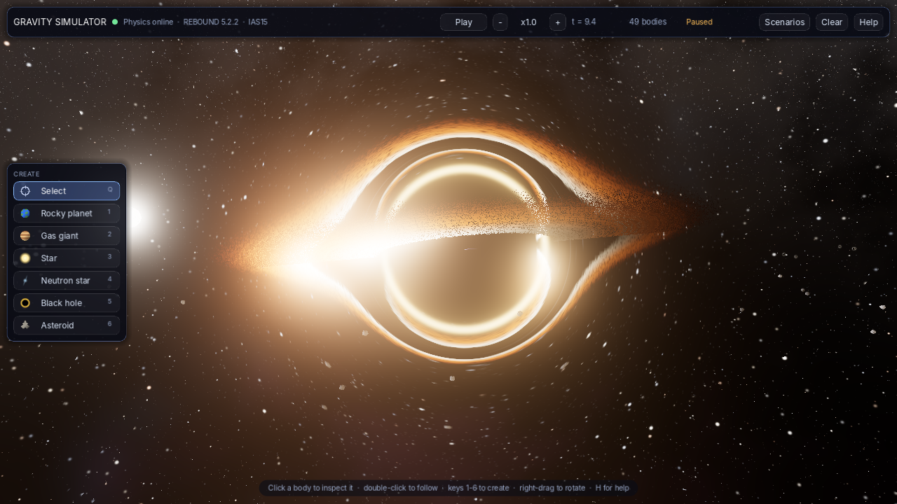
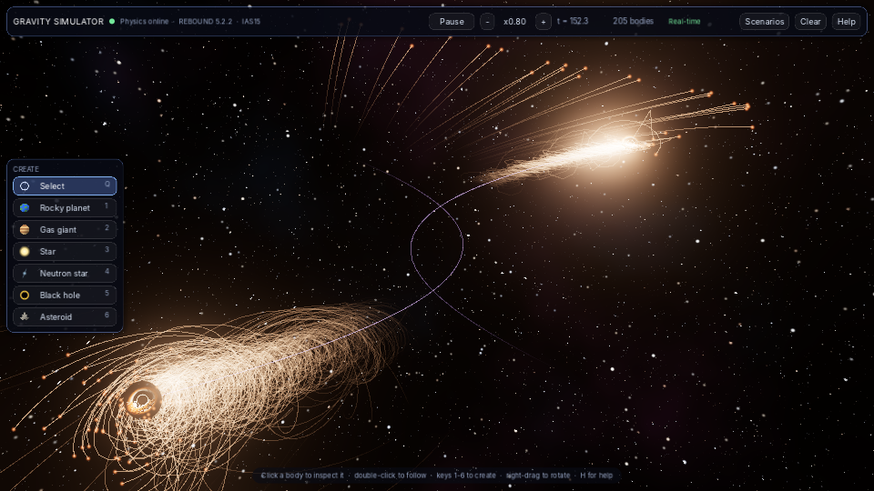
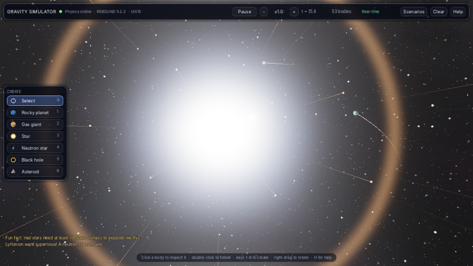
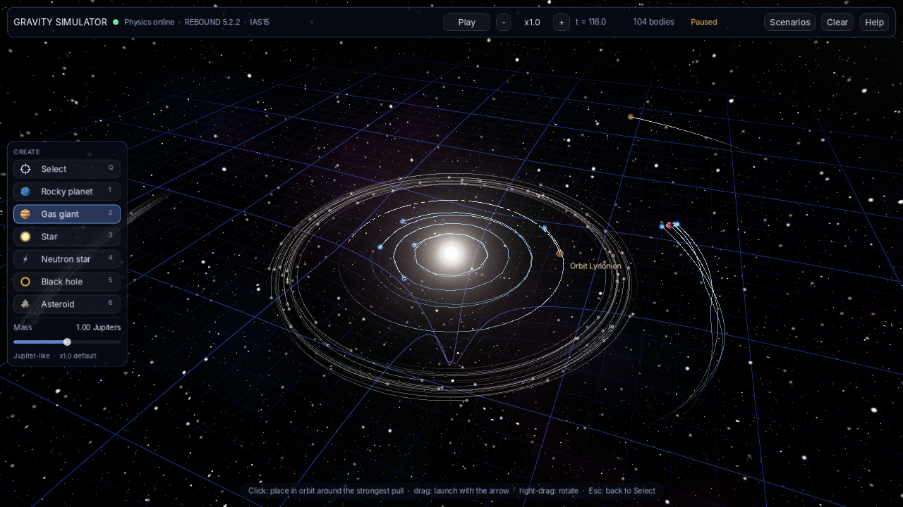

# Gravity Simulator

An interactive space sandbox for Windows. You start in empty space, drop in planets, stars, neutron stars and black holes, and watch real N-body gravity take over: orbits, slingshots, collisions that shatter planets, stars torn apart by black holes, supernovae, and colliding galaxies.



The physics runs on **[REBOUND](https://rebound.hanno-rein.de/)**, an open-source N-body code used in professional astrophysics research. Everything you see is drawn by **[Godot](https://godotengine.org/)**, a free open-source game engine.

| | |
|---|---|
|  |  |
| Two galaxies fly past each other and throw out tidal tails | A star goes supernova and its shock wave sweeps through the system |


*Placing a gas giant. The dashed line is REBOUND's forecast of the new orbit; the grid sags into the Sun's gravity well.*

---

## Contents

1. [What it does](#1-what-it-does)
2. [Quick start (5 steps)](#2-quick-start-5-steps)
3. [Detailed installation on Windows](#3-detailed-installation-on-windows)
4. [How to play](#4-how-to-play)
5. [The physics, explained](#5-the-physics-explained)
6. [How the project is built](#6-how-the-project-is-built)
7. [Customising and extending](#7-customising-and-extending)
8. [Making a stand-alone .exe (optional)](#8-making-a-stand-alone-exe-optional)
9. [Developing with Codex](#9-developing-with-codex)
10. [Troubleshooting](#10-troubleshooting)
11. [Credits and licences](#11-credits-and-licences)

---

## 1. What it does

- **True N-body gravity.** Every massive body pulls on every other one, integrated with REBOUND's IAS15, an adaptive 15th-order integrator that stays accurate through close encounters and slingshots.
- **Seven kinds of body:** rocky planets, gas giants, stars (coloured by temperature), neutron stars (pulsars), black holes, asteroids, and hot gas clouds.
- **Collisions with consequences:**
  - Gentle impacts merge, conserving mass and momentum. The survivor glows molten for a while.
  - Violent impacts shatter planets into fragments, using a simplified version of the Leinhardt & Stewart (2012) law that planetary scientists use.
  - Black holes swallow anything that crosses their event horizon, and their accretion disks flare up and fire jets while they feed.
  - Bodies that pass inside a heavier body's Roche limit are torn apart by tides ("spaghettification").
- **Stellar life cycle:**
  - Gas giants that grow past about 80 Jupiter masses ignite into stars.
  - Neutron stars pushed past about 2.3 solar masses collapse into black holes.
  - Colliding neutron stars make a kilonova.
  - Black-hole mergers radiate 5% of their mass as gravitational waves.
  - You can make any star go supernova.
- **Live orbit forecast.** Before you place a body, REBOUND simulates where it will go and draws the path, warning you about collision courses.
- **Visuals:**
  - Procedural planets and stars, with gravitational lensing around black holes.
  - Doppler-beamed accretion disks and bloom.
  - Orbit trails, a "rubber sheet" gravity grid, and impact effects.
- **Seven built-in scenarios:** Solar system, Binary stars, Black hole feast, Planet smash, Planet formation, Colliding galaxies, and Empty space.

## 2. Quick start (5 steps)

If you are comfortable installing software, this is all you need. Otherwise follow [section 3](#3-detailed-installation-on-windows), which explains every click.

1. Install **Python 3.13** from [python.org](https://www.python.org/downloads/windows/). Python 3.12 and 3.14 also work. See [3.2](#32-install-python-313) for why not 3.15 yet.
2. Install **Godot 4.6 or newer**, the standard edition, not .NET, from [godotengine.org](https://godotengine.org/download/windows/).
3. Unzip `gravity-simulator.zip` into a simple folder such as `Documents`. The zip already contains a `gravity-simulator` folder, so extract to `Documents`, not `Documents\gravity-simulator` ([3.1](#31-get-the-project-files)).
4. Double-click **`setup_physics_server.bat`** and wait for "Self-test PASSED". If Windows won't run it, use the [manual commands](#33-set-up-the-physics-server) instead.
5. Open Godot, choose **Import**, select `gravity-simulator\godot\project.godot`, then press **F5**.

Godot starts the physics server for you. Pick a scenario on the welcome screen, or choose a body on the left and click into space.

## 3. Detailed installation on Windows

### 3.0 What you are installing, and why

| Component | What it does | Size | Cost |
|---|---|---|---|
| **Python 3.13** | Runs the physics server | about 100 MB | free |
| **REBOUND + NumPy** | The physics engine and fast maths, installed for you by the setup script into a private folder (`physics_server\.venv`) | about 60 MB | free, open source |
| **Godot 4.6+** | Draws everything and handles your mouse and keyboard. No installer: it is a single .exe | about 150 MB | free, open source |

**System requirements:**
- Windows 10 or 11, 64-bit.
- Any graphics card or integrated GPU from roughly the last ten years. Godot's default renderer needs Vulkan or Direct3D 12; on older GPUs it falls back to OpenGL automatically.
- An internet connection for the one-time setup.

Nothing needs administrator rights except, optionally, the Python installer.

### 3.1 Get the project files

1. Download `gravity-simulator.zip`.
2. *(Recommended)* Right-click the zip, choose **Properties**, tick **Unblock** at the bottom if it is there, and click **OK**. This tells Windows the files are trusted, so it won't block the setup script later.
3. In File Explorer, **right-click the zip, then choose Extract All...**
4. **Watch the destination box.** Windows suggests a folder named after the zip, such as `...\Downloads\gravity-simulator`. The zip *already* contains a `gravity-simulator` folder, so that would give you `gravity-simulator\gravity-simulator\...`, and Godot then can't find `project.godot`. Change the destination to the parent folder you want, for example `C:\Users\<you>\Documents`, and click **Extract**.
   - Don't run things from inside the zip without extracting it: Windows shows the files, but the scripts can't work there.
   - Avoid very long paths and network drives. A OneDrive-synced Documents folder is fine.
5. You should now have a folder `gravity-simulator` containing the files below. If you open it and find *another* `gravity-simulator` folder instead, that inner folder is the real project; use it for everything.

```
gravity-simulator\
├── README.md                    <- this file
├── setup_physics_server.bat     <- run once
├── start_physics_server.bat     <- optional: start the physics by hand
├── physics_server\              <- Python + REBOUND physics
├── godot\                       <- the Godot project (graphics and controls)
└── docs\                        <- screenshots and runtime reference
```

### 3.2 Install Python 3.13

Use Python 3.13 on Windows. The supported range is Python 3.10–3.14. The project uses a private `.venv`; Python 3.13 must be installed but does not need to be your default interpreter.

**First check whether you already have it.** Open PowerShell (Start menu, type `powershell`, press Enter) and run:

```powershell
py -3.13 --version
```

If it prints `Python 3.13.x`, skip to [3.3](#33-set-up-the-physics-server). If it prints an error, install it using **one** of the two options below.

**Option A: Python Install Manager** (what python.org now recommends)

1. Go to <https://www.python.org/downloads/windows/> and download the **Python install manager**. It is also in the Microsoft Store as "Python Install Manager", or you can install it from PowerShell with `winget install 9NQ7512CXL7T`.
2. Run it and accept the defaults.
3. Open a **new** PowerShell window and run:

   ```powershell
   py install 3.13
   ```

4. Check that it worked:

   ```powershell
   py -3.13 --version
   ```

**Option B: the classic installer**

1. On <https://www.python.org/downloads/windows/>, find the latest **Python 3.13.x** release and download **"Windows installer (64-bit)"**.
2. Run it. On the first screen, leave "Use admin privileges when installing py.exe" ticked if it is shown. You can leave **"Add python.exe to PATH" unticked**: that box would make 3.13 your default `python`, and this project doesn't need it because it uses the `py` launcher.
3. Click **Install Now**, then **Close**.
4. Open a **new** PowerShell window and check:

   ```powershell
   py -3.13 --version
   ```

> **Microsoft Store pop-up?** Typing `python` on a fresh Windows can open the Microsoft Store instead of running Python. That is a Windows shortcut, not a real Python. Use the `py -3.13` command shown above, or turn the shortcut off in **Settings, then Apps, then Advanced app settings, then App execution aliases**, by switching off the two "python" entries.

### 3.3 Set up the physics server

1. Open the `gravity-simulator` folder and **double-click `setup_physics_server.bat`**.
2. If Windows shows **"Windows protected your PC"**, click **More info**, then **Run anyway**. Windows shows this for any script downloaded from the internet. The file is plain text; you can open it in Notepad to read exactly what it does.
   - If Windows refuses outright, with no "Run anyway" option, that is usually **Smart App Control** on Windows 11, which blocks downloaded `.bat` files. Use the **manual commands** below instead; they do exactly the same thing. Alternatively, unblock the zip as in [3.1](#31-get-the-project-files) and extract it again.
3. A black window opens and works through four steps:

   ```
    [1/4] Found Python 3.13.x
    [2/4] Creating a virtual environment in physics_server\.venv ...
    [3/4] Installing REBOUND and NumPy (this can take a minute) ...
    [4/4] Running the physics self-test ...

     [ok] scenario 'solar' loads and runs - 112 bodies, 18 ms
     ...
     [ok] solar system runs faster than real time at the default speed

   Self-test PASSED - you're ready to go!
   ```

4. Press any key to close the window.

What just happened: the script created a private Python environment in `physics_server\.venv`, so nothing is installed system-wide. It installed REBOUND and NumPy from PyPI into it, then ran `server.py --selftest`. The self-test exercises every physics feature: mergers, shattering, tidal disruption, supernovae, ignition, kilonovae, orbit forecasts, and speed.

**Manual commands** (if the `.bat` is blocked, or you prefer to see each step). Open the `physics_server` folder in File Explorer, right-click empty space, choose **Open in Terminal**, and run:

```powershell
cd "$HOME\Documents\gravity-simulator\physics_server"   # not needed if you used "Open in Terminal"
py -3.13 -m venv .venv
.\.venv\Scripts\python.exe -m pip install --upgrade pip
.\.venv\Scripts\python.exe -m pip install -r requirements.txt
.\.venv\Scripts\python.exe server.py --selftest
```

There is no need to "activate" the environment, and no PowerShell execution-policy changes are needed, because these commands call the environment's `python.exe` directly. Once the self-test passes you never need the `.bat` files: Godot finds `physics_server\.venv` and starts the server itself.

### 3.4 Install Godot

1. Go to <https://godotengine.org/download/windows/> and download **Godot Engine**, the standard build. **Do not** pick the ".NET" build; this project uses GDScript, which the standard build includes.
   - Use **Godot 4.6+**. CI uses Godot 4.6.3.
   - Godot is also on Steam and itch.io if you prefer those.
2. You get a zip such as `Godot_v4.7.2-stable_win64.exe.zip`. Extract it anywhere, for example `C:\Tools\Godot\`.
3. Double-click `Godot_v4.x-stable_win64.exe`. There is no installer. (The other file, `..._console.exe`, is the same program with a console window. You don't need it to play, but it is the one to give Codex, see [section 9](#9-developing-with-codex), because it prints errors to the terminal.)

### 3.5 Open the project in Godot

1. In the Godot **Project Manager**, click **Import**. In older 4.x versions it is the **Import** button in the top bar.
2. Browse to `gravity-simulator\godot\` and select **`project.godot`**.
3. Click **Import** (or **Import & Edit**).
4. The first time, Godot spends a minute importing the project and compiling shaders. This happens only once.
5. If Godot says the project was made with a different version, click **OK** or **Convert**. That is harmless.

### 3.6 Run it

Press **F5**, or click the ▶ **Play** button at the top right of the editor.

- After about a second the top bar shows a green dot and **"Physics online · REBOUND 5.x · IAS15"**. Godot found `physics_server\.venv` and started the server in the background; it stops it again when you close the game.
- The welcome screen offers scenarios. Click **Black hole feast** for an immediate spectacle.
- If you see **"Waiting for the physics server..."** instead, see [section 10](#10-troubleshooting).

**Firewall:** the server only listens on `127.0.0.1`, so nothing is reachable from other computers. If Windows Firewall asks anyway, either answer is fine.

### 3.7 (Optional) Running the physics server by hand

Double-click **`start_physics_server.bat`** and leave its window open. You get a live log of connections and errors, which is handy when you are changing the physics code. Godot detects the running server and won't start a second one.

Server options (add them after `server.py`, or after the `.bat` name in a terminal):

| Option | Meaning |
|---|---|
| `--max-bodies 900` | Allow more bodies (default 600). More bodies means slower physics. |
| `--port 47810` | UDP port. If you change it, also change `SERVER_PORT` in `godot/scripts/net_client.gd`. |
| `--verbose` | Log every command Godot sends. |
| `--selftest` | Run the checks and exit. |
| `--log FILE` | Also write the log to a file. Godot uses `physics_server\server.log` when it starts the server. |

## 4. How to play

### Building

1. Pick a body on the left, or press **1** to **6**: Rocky planet, Gas giant, Star, Neutron star, Black hole, Asteroid.
2. Move the mouse into space. A ghost of the body follows the cursor on the plane through the camera's focus point. REBOUND forecasts its orbit around **whatever pulls hardest at that spot**, shown as a dashed line, with a blue ring around the body it will orbit.
3. Then do one of these:
   - **Click** to place it on a circular orbit. If the new body is heavier than what it orbits, the two share the orbit around their common centre of mass, which is how you build binary stars.
   - **Drag** to launch it instead. The arrow sets direction and speed. The caption tells you the speed as a multiple of orbital speed: about 1.0x stays in orbit, 1.41x escapes, below 1 falls inward. Right-click while dragging to cancel.
   - **Shift + click with the Asteroid tool** to create a belt of 80 asteroids. Near a planet, that makes a planetary ring.
4. Use the **Mass** slider to scale the body from 0.1x to 10x its default. The label tells you what you are making, for example "Red dwarf", "Super-Earth" or "Blue giant".

### Watching

- **Select** (Q or Esc): click a body to open the inspector. It shows mass, size, speed, what the body orbits, temperature and spectral class for stars, and whether the surface is molten.
- **Double-click** a body, or press **F**, to follow it. Trails then switch to that body's frame of reference, so moons draw neat loops around their planet.
- **Supernova!** in the inspector, or **N**, makes the selected star explode.
- **Delete** removes the selected body.

### Controls

| Mouse / key | Action |
|---|---|
| Left click / drag | Place / launch a body (body tools), or select (Select tool) |
| Double-click | Follow a body |
| Right drag, **or** Alt + left drag | Orbit the camera |
| Middle drag, **or** Shift + right drag, **or** W A S D | Pan |
| Mouse wheel / touchpad pinch | Zoom |
| Arrow keys | Orbit the camera with the keyboard |
| 1 – 6 | Body tools |
| Q / Esc | Back to Select (Esc also closes help and cancels drags) |
| Space | Pause / resume |
| − / + | Slow down / speed up time (×0.1 to ×64) |
| F | Follow / unfollow the selected body |
| Delete / Backspace | Delete the selected body |
| N | Supernova (selected star) |
| T | Trails: off / short / long |
| G | Gravity grid on/off (it always appears while placing) |
| R | Reset the view to frame everything |
| Tab | Hide the interface (for screenshots) |
| F12 | Save a screenshot to `%APPDATA%\Godot\app_userdata\Gravity Simulator\screenshots\` |
| H / F1 | Help |

### The scenarios

| Scenario | What to watch for |
|---|---|
| **Solar system** | A Sun, four rocky planets (Earth has a Moon), an asteroid belt, a Jupiter with moons, a ringed Saturn and an ice giant. Try dropping a black hole through it. |
| **Binary stars** | Two suns in orbit, a planet around one of them on the edge of stability, and circumbinary planets. |
| **Black hole feast** | A star on a plunging orbit is torn apart near the black hole. The debris streams in and the disk and jets flare. |
| **Planet smash** | Two Earths collide at about 8 times their escape speed and shatter into glowing fragments. |
| **Planet formation** | 200 planetesimals around a young Sun collide, merge and slowly build planets. Runs at 2.5x speed. |
| **Colliding galaxies** | Two black-hole-centred galaxies make a close pass and throw out tidal tails and bridges, as in Toomre & Toomre (1972). |
| **Empty space** | Your canvas. |

The top bar shows simulation time, the body count, and **"Real-time"**, which turns amber with a percentage if the physics can't keep up with the requested speed. Lower the speed or remove debris if that happens.

## 5. The physics, explained

### Units

Gravity uses `G = 1`. Masses use real ratios: the Sun is 1000 units, Jupiter about 1, and Earth about 0.003. Time and distance are scaled so that an Earth-like orbit takes about 9 seconds at x1 speed.

**Sizes are exaggerated**, as in every space game. A to-scale Earth would be smaller than one pixel at the distance of its orbit. Collisions use these exaggerated sizes, so impacts are more frequent than in reality.

### Gravity and integration

All bodies live in one REBOUND simulation using the **IAS15** integrator (Rein & Spiegel 2015). It is adaptive: it takes tiny steps during close encounters and big ones in quiet periods, and it is accurate to roughly machine precision. The server advances the simulation in real time (60 updates a second). Godot draws smoothly between updates using each body's velocity and acceleration.

Debris (asteroids and small gas clouds) is treated as **test particles**. It feels everyone's gravity and collides normally, but doesn't pull on other bodies. This is the classic approximation (Toomre & Toomre used it for colliding galaxies) and makes debris-heavy scenes about 10 times faster. Planets, stars, neutron stars and black holes are always fully N-body.

### Collisions (`world.py → _handle_collision`)

| Situation | Outcome |
|---|---|
| Anything touches a **black hole** | Swallowed. The black hole gains the mass and momentum and its disk flares. |
| Two black holes | Merge; 5% of the mass is radiated as gravitational waves, roughly what LIGO measures. |
| Two neutron stars | **Kilonova**: 3% of the mass is ejected as hot gas, and above 2.3 solar masses the remnant becomes a black hole. |
| A star and a smaller body | The star engulfs it. Fast star–star impacts can splash hot gas. |
| Everything else | Specific impact energy `Q_R` is compared with the disruption threshold `Q*` (about escape speed squared, corrected for small projectiles). If the bodies meet below 1.25x escape speed, or the largest remnant keeps more than 93% of the mass, they **merge**. Otherwise they **shatter**: the largest remnant keeps `M_tot (1 − Q_R / 2Q*)` and the rest becomes 2 to 16 fragments with a power-law mass spread. Fragments fly out faster than the remnant's escape speed, with total momentum conserved exactly. |

### Tides

A body of density ρ passing a heavy body of mass M is torn apart inside `r ≈ 1.1 (M / ρ)^(1/3)`, if that limit lies outside both bodies. Its fragments are laid out along the line to the heavy body (spaghettification) and then shear into a stream.

### Growing and dying

- Asteroids that grow past a Mars mass become rocky planets.
- Rocky planets past about 10 Earth masses become gas giants (runaway gas accretion).
- Gas giants past about 80 Jupiter masses ignite as stars (the hydrogen-burning limit).
- Neutron stars past about 2.3 solar masses collapse into black holes.
- A **supernova** blows 75% of the star outwards as 48 gas clouds and leaves a neutron star or black hole. In reality only stars above about 8 solar masses do this, and the game tells you so.

### Visual-only effects

None of these affect the physics:
- Lensing, accretion disks, jets, pulsar beams.
- Flashes, shock waves and debris sparks.
- The gravity grid, which shows the Newtonian potential and is a teaching picture rather than literal spacetime.

### What is *not* simulated

- General relativity. Orbits are Newtonian; black holes are Newtonian point masses with a capture radius.
- Radiation pressure.
- Fluid dynamics: bodies are spheres, not SPH particles.
- Rotation and tidal locking.
- Stellar evolution over time.

The forecast line uses the 20 most influential bodies, so in crowded scenes it is a very good approximation rather than exact.

## 6. How the project is built

```
 ┌──────────────────────────── Godot (graphics, input) ────────────────────────────┐
 │ main.gd ── builds the scene, smooths motion, handles input                       │
 │   ├─ net_client.gd   UDP link; auto-starts the server                            │
 │   ├─ body_view.gd    one node per body (planet/star/black hole visuals)          │
 │   ├─ camera_rig.gd   orbit camera        ├─ trails.gd      orbit trails          │
 │   ├─ placement.gd    ghost + forecast    ├─ space_grid.gd  gravity grid          │
 │   ├─ effects.gd      flashes, shock waves├─ hud.gd         interface             │
 │   └─ shaders/        star, planets, lensing, accretion disk, starfield ...       │
 └──────────────▲──────────────────────────────────────┬───────────────────────────┘
                │ binary state, 60 per second          │ JSON commands
                │ (positions, velocities, events)      │ (add, predict, pause, ...)
 ┌──────────────┴──────────────── Python ──────────────▼───────────────────────────┐
 │ server.py ── UDP on 127.0.0.1:47810, real-time loop, self-test                   │
 │ world.py  ── REBOUND simulation: IAS15, collisions, tides, supernovae, scenarios │
 └──────────────────────────────────────────────────────────────────────────────────┘
```

**Why two programs?** REBOUND is a C library with a Python interface, and Godot can't run Python directly. Embedding it would mean writing C++ glue. A tiny UDP link on your own machine keeps both sides simple, lets you change the physics without touching the graphics, and adds well under a millisecond of delay.

### Protocol (if you want to build your own front end)

The [generated runtime reference](docs/runtime-reference.md) lists checked constants, body IDs, events and scenarios. CI rejects stale generated documentation and compares Python with executed Godot values.

Commands are validated before changing the simulation. Vectors must contain exactly three finite numbers in ±1,000,000; mass multipliers must be between 0.000001 and 1,000,000. IDs and request numbers must be integers up to 16,000,000; belt counts must be 1–1321. Invalid commands are ignored (logged with `--verbose`), including unknown presets. `--max-bodies` is limited to 1–1321 so state packets fit in a UDP datagram.

**Commands** are UTF-8 JSON, one per UDP packet, sent to port 47810:
- `hello` — heartbeat; send it about twice a second.
- `add` — `{type, pos, mode: "orbit"|"launch", drag, mass_mult}`
- `predict` — same fields as `add`, plus `req`.
- `belt` — `{pos, count, mass_mult}`
- `remove` — `{id}`
- `supernova` — `{id}`
- `pause` — `{value}`
- `speed` — `{value}`, in simulation time units per second.
- `clear`
- `preset` — `{name}`
- `bye`

**State packets** are little-endian float32 arrays:
- **Header**, 10 values: `[1, version, t_hi, t_lo, N, E, paused, speed, perf, max_bodies]`. The simulation time is `t_hi + t_lo`.
- **N bodies**, 12 values each: `[id, type, x, y, z, vx, vy, vz, mass, radius, heat, age]`.
- **E events**, 8 values each: `[kind, x, y, z, magnitude, size, id_a, id_b]`.

**Forecast replies** start with `2`: `[2, req, n_points, hit, attractor_id, vx, vy, vz]`, followed by the points.

The server also sends occasional JSON messages: `info`, `preset` (camera hints) and `notice` (text).

UDP commands and events have no acknowledgements or retries. Delivery and ordering are not guaranteed. The default endpoint is localhost; the protocol has no authentication.

## 7. Customising and extending

Physics knobs (top of `physics_server/world.py`):

| Constant | Default | Effect |
|---|---|---|
| `DEFAULT_MASS` | Sun 1000, Jupiter 1, Earth 0.003 ... | Mass of each body type at slider position x1 |
| `GAS_TO_STAR`, `NEUTRON_TO_BH`, ... | 80, 2300, ... | When bodies change type |
| `TIDAL_K` | 1.1 | Bigger values tear things apart from further away |
| `SHATTER_MIN_MASS`, `MIN_FRAGMENT_MASS` | 1e-4, 5e-6 | How eagerly impacts make debris |
| `LIGHT_MASS` | 0.5 | Asteroids and gas clouds lighter than this are test particles |
| `radius_for()` | — | The size of each body type |

**Add a scenario:** in `world.py → load_preset()`, add a branch:

```python
elif name == "my_scene":
    self.add_body(STAR, 1000.0, (0, 0, 0), (0, 0, 0))
    p, v = self.orbit((0, 0, 0), (0, 0, 0), 1000.0, 80.0)   # circular orbit, radius 80
    self.add_body(GAS_GIANT, 2.0, p, v)
    cam = {"focus": [0, 0, 0], "distance": 250.0, "pitch": 0.6}
```

Then add `["my_scene", "My scene", "Description"]` to `PRESETS` in `godot/scripts/hud.gd`.

**Change the look:** each body type's appearance is a shader in `godot/shaders/`. Colours and names are in `godot/scripts/palette.gd`. Glow and tone mapping are in `main.gd → _setup_environment()`.

**Command-line options for Godot** (handy for screenshots; put them after `--`):

```
Godot_v4.x-stable_win64.exe --path godot -- --preset=black_hole --wait=6 --screenshot=shot.png --quit
```

## 8. Making a stand-alone .exe (optional)

**Export the Godot side:**

1. In Godot, open **Editor → Manage Export Templates** and click **Download and Install** (one time).
2. Open **Project → Export → Add... → Windows Desktop**.
3. Export into a new folder **inside** `gravity-simulator`, for example `gravity-simulator\build\GravitySimulator.exe`.

The game looks for `physics_server\` next to the .exe and one folder up, so it finds the server automatically.

**Bundle the physics server so the player needs no Python** (advanced):

```powershell
cd gravity-simulator\physics_server
.\.venv\Scripts\python.exe -m pip install pyinstaller
.\.venv\Scripts\pyinstaller.exe --onefile --name server --collect-all rebound server.py
```

This creates `physics_server\dist\server.exe`, which the game starts automatically if it finds it. You can then ship the `build\` folder plus `physics_server\dist\server.exe`, keeping the same layout.

Two caveats:
- Some antivirus tools flag one-file PyInstaller builds by mistake.
- Shipping REBOUND means following its licence; see [section 11](#11-credits-and-licences).

## 9. Developing with Codex

[Codex](https://developers.openai.com/codex/) is the primary coding assistant for this project. Open the repository in Codex, or run the Codex CLI from this folder. The same instructions work for Windows development and Linux cloud tasks.

| File | Purpose |
|---|---|
| `AGENTS.md` | Repository guidance: architecture, commands, physics invariants, conventions and validation requirements |
| `.agents/skills/selftest/SKILL.md` | `$selftest`: run and diagnose the physics self-test |
| `.agents/skills/visual-check/SKILL.md` | `$visual-check`: render a scenario and inspect its screenshot |
| `tools/dev.py` | Cross-platform setup, physics tests, headless Godot checks and screenshot capture |

**Local setup:** install Python 3.13 and standard Godot 4.6+ as described above. If Godot is not on PATH, set `GODOT` to its executable. On Windows, use the console build so Codex can read errors. For example, in PowerShell:

```powershell
$env:GODOT = "C:/Tools/Godot/Godot_v4.6.3-stable_win64_console.exe"
py -3.13 tools/dev.py setup
py -3.13 tools/dev.py godot-check
```

On Linux/macOS, replace `py -3.13` with `python3`. The helper uses `physics_server/.venv` without requiring activation and can be called by its absolute path from another directory.

**Development checks:**

```sh
python3 tools/dev.py selftest
python3 tools/dev.py godot-check
python3 tools/dev.py visual-check black_hole --pause_at=2 --grid
```

**Automated quality checks:** run `py -3.13 tools/dev.py setup-dev` once, then `py -3.13 tools/dev.py check` (use `python3` on Linux/macOS). This runs Ruff, regression tests with branch coverage, generated-documentation checks, Python/Godot contract comparisons, and a headless startup that must receive live physics bodies. Individual commands are `lint`, `test`, `docs-check`, and `godot-check`. Run `docs` to regenerate [the runtime reference](docs/runtime-reference.md).

GitHub Actions runs Python checks on Windows and Linux for Python 3.10–3.14, plus Godot 4.6.3 on Linux. Runtime dependencies are pinned; Dependabot proposes reviewed updates weekly. CI never automatically merges dependency changes. Configure repository branch protection to require the Quality jobs before merging; committing a workflow alone does not enforce this.

Headless tests do not cover rendered appearance, Windows installers, exported builds or long-duration numerical accuracy.

Generated checks cover runtime facts, not all prose. Review README controls, setup instructions and physics explanations when behavior changes; the PR checklist records that review.

Ask Codex to “use $selftest” or “use $visual-check for black_hole” to apply the corresponding skill. Screenshots get unique names in ignored `shots/`; Codex must open the image to assess the result. Visual checks require a display and working graphics renderer. A headless check validates scripts and startup, not image quality.

Codex reads `AGENTS.md` and discovers skills under `.agents/skills/`. Tool permissions are managed by your Codex app or environment settings. Machine-specific paths belong in environment variables, not committed files.

## 10. Troubleshooting

| Symptom | Fix |
|---|---|
| **"Waiting for the physics server..."** and the box says `no .venv found` | You haven't run `setup_physics_server.bat` yet, or it failed. Run it and read its last lines. |
| "Waiting..." even though setup passed | Click **Try to start it automatically again**. If that doesn't help, double-click `start_physics_server.bat` and read the window: any error appears there. Also check `physics_server\server.log`. |
| Godot says it can't find `project.godot` | You probably have a doubled folder (`gravity-simulator\gravity-simulator\...`) or picked the wrong folder. In Godot's **Import** dialog, browse into `gravity-simulator\godot\` and select the `project.godot` file itself. See [3.1](#31-get-the-project-files). |
| Windows refuses to run `setup_physics_server.bat` | Smart App Control or SmartScreen is blocking downloaded scripts. Run the [manual commands](#33-set-up-the-physics-server) in a terminal instead; they do the same thing. |
| The setup window flashes and closes | Open a terminal in the `gravity-simulator` folder (in Explorer, right-click empty space and choose "Open in Terminal"; on Windows 10, Shift + right-click, then "Open PowerShell window here") and run `.\setup_physics_server.bat` to see the message. |
| "Python 3 was not found" or the Microsoft Store opens | Install Python as in [3.2](#32-install-python-313), then open a **new** window. Check with `py -3.13 --version`. |
| `pip` fails with "Microsoft Visual C++ 14.0 is required" or "Building wheel for rebound failed" | Your Python is newer than REBOUND's ready-made packages (for example 3.15). Install Python 3.13 ([3.2](#32-install-python-313)), delete `physics_server\.venv`, and run the setup again. The script prefers 3.13 automatically when it is installed. |
| `pip` fails with SSL, proxy or timeout errors | Check your internet connection. On a work network a proxy may block PyPI; try another network or ask IT. |
| "Could not listen on 127.0.0.1:47810" | A physics server is already running. Close its window, or end `python.exe` / `pythonw.exe` in Task Manager. |
| Godot shows a blank screen, crashes on start, or says Vulkan isn't supported | Update your graphics driver. If that doesn't help: **Project → Project Settings → Rendering → Renderer → Rendering Method → `gl_compatibility`**, then restart Godot. (Glow is slightly simpler there; everything else works.) |
| Low frame rate | Press **T** to turn trails off, lower the body count, and make sure the laptop is plugged in and using its dedicated GPU (Windows **Settings → System → Display → Graphics**, set Godot to "High performance"). |
| "Physics at 40%" in amber | The simulation can't keep up with the chosen speed. Press **−**, delete debris, or **Clear**. Many simultaneous close encounters force IAS15 into tiny time steps. |
| Bodies vanish far away | Anything that gets more than 15,000 units from the centre is removed as "escaped". |
| Starting completely fresh | Delete `physics_server\.venv` and `godot\.godot`, then repeat [3.3](#33-set-up-the-physics-server) and [3.5](#35-open-the-project-in-godot). |

## 11. Credits and licences

- **REBOUND** by Hanno Rein and contributors. Licensed under **GPL-3.0**. Papers: Rein & Liu 2012 (A&A 537, A128); IAS15: Rein & Spiegel 2015 (MNRAS 446, 1424). <https://github.com/hannorein/rebound>
- **Godot Engine**, MIT licence. <https://godotengine.org>
- **NumPy**, BSD-3-Clause licence.
- Science behind the effects:
  - Leinhardt & Stewart 2012 (ApJ 745, 79), collision outcomes.
  - Toomre & Toomre 1972 (ApJ 178, 623), galactic bridges and tails.
  - The black-hole look follows the lensing studies done for *Interstellar* (James, von Tunzelmann, Franklin & Thorne 2015).
- Inspiration: [Universe Sandbox](https://universesandbox.com/), the gold standard of space sandboxes.

**About licences:** the Python physics server imports REBOUND, so if you *distribute* it, in particular the PyInstaller `server.exe`, the GPL-3.0 terms apply to that part. The Godot front end is a separate program that only exchanges messages over a socket. The project's own code has no licence attached yet; choose one before sharing it publicly. This is general information, not legal advice.
